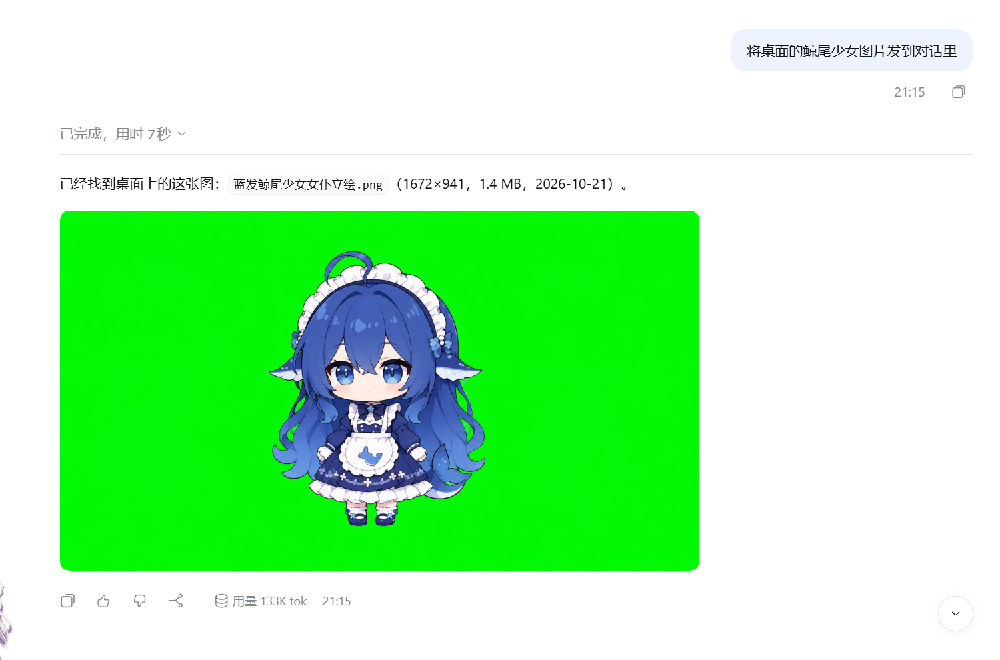
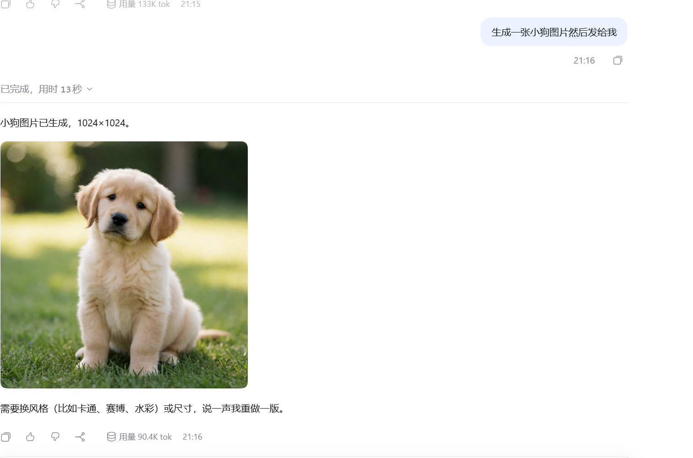

# imgpost（图邮）

让 DSH 助手把图片直接发到聊天里给你看，也支持生图和识图。

- **发图**：DSH 助手把本地图片、网页图片直接发给你看。
- **生图**：连接 OpenAI 兼容的图片生成服务。
- **识图**：调用你配置的视觉服务，支持图片描述、文字识别和看图问答。
- **设置**：在 DSH 的「图邮（识图）」页面管理视觉后端。

## 实测截图

让 DSH 助手把本地图片直接发到对话里：



让 DSH 助手生成图片，再发给你看：



## 安装

在 DSH 插件面板中添加 `imgpost`，或运行：

```sh
dsh plugin --profile desktop add imgpost
```

Web 版把 `desktop` 换成 `web`。安装后重启 DSH。

## 使用

直接在对话里提出要求，例如：

- “把这张本地图片发给我看。”
- “生成一张雨夜街景。”
- “读一下这张截图里的文字。”

发图无需配置外部 API。生图、识图需要先填写你自己的服务地址、模型和凭据：

- **识图**：打开设置中的「图邮（识图）」。
- **生图**：在 `~/.dsh/image-sender.json` 中填写 `baseURL`、`model` 和 `apiKey`。

DSH 原生视觉模型可以直接读图；需要继续使用文本模型时，可选择插件提供的 `imgpost-<上游>` 通道。

## 说明

- 识图会把图片发送到你配置的视觉服务，结果缓存在本机。
- 图片链接没有额外登录校验，请仅在可信环境中分享。
- 当前发图、生图流程使用 PowerShell；其他系统尚未验证。

[详细配置](docs/advanced.md) · [更新记录](CHANGELOG.md) · [反馈问题](https://github.com/hige6/imgpost/issues)

MIT License
